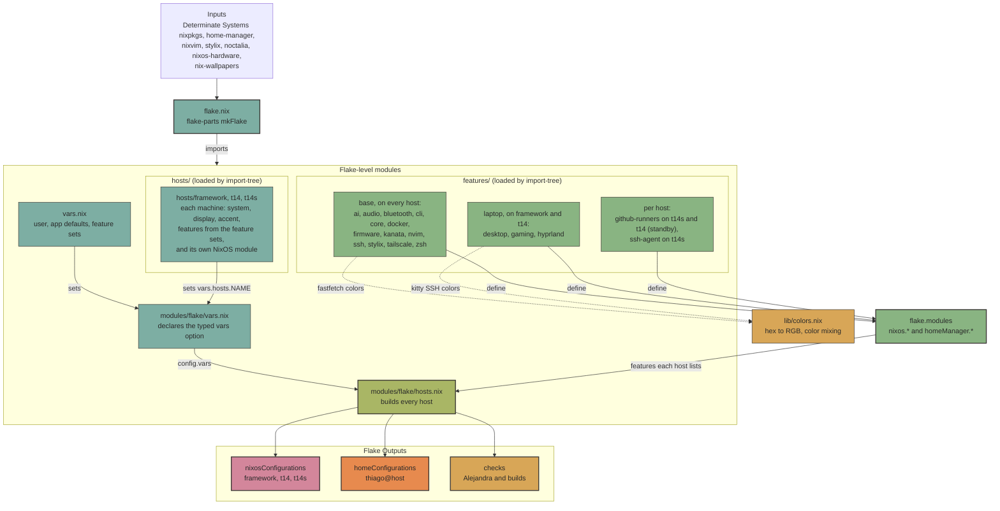

# ❄️ thiagokimo's NixOS & Home Manager Configuration

<div align="center">

[](https://nixos.org)
[-4bbaea.svg?logo=hyprland&logoColor=white&style=for-the-badge)](https://hyprland.org)
[](https://github.com/noctalia-dev/noctalia-shell)
[](https://github.com/nix-community/nixvim)
[-ff69b4.svg?style=for-the-badge)](https://github.com/nix-community/stylix)
[-d3869b.svg?style=for-the-badge)](https://github.com/viperML/nh)
[](LICENSE)

*A modular multi-host setup managed through **Nix Flakes** and **flake-parts**, featuring **Determinate Systems cooled channels**, a unified **Gruvbox Dark Hard** palette, a Lua-compiled **Hyprland** desktop powered by **Noctalia Shell**, declarative **Nixvim**, a **Starship** prompt styled like the bar, low-latency **Kanata** dual-role keys, a self-hosted CI server, and **nh** workflow automation.*

---

[Key Features](#-key-features) • [Screenshots](#-screenshots) • [Architecture & Flake Design](#%EF%B8%8F-architecture--flake-design) • [Hardware & Hosts](#%EF%B8%8F-hardware--hosts) • [Desktop & Noctalia Shell](#-desktop--noctalia-shell) • [System Services & Base](#%EF%B8%8F-system-services--base) • [CLI, Nixvim & User Space](#-cli-nixvim--user-space) • [Directory Layout](#-directory-layout)

</div>

---

## ✨ Key Features

- **❄️ Determinate Systems Cooldown Channels**: Tracks Determinate Systems weekly cooled unstable (`nixpkgs-weekly`) for stability, with the chilled stable channel (`nixpkgs-26.05-chilled`) available as `pkgs.stable`.
- **🌳 Dendritic Flake Layout**: Every file under `features/` and `hosts/` is a flake-parts module loaded by `import-tree`. A host picks its features from named feature sets, and one NixOS and one Home Manager configuration are built per host.
- **🎛️ Multi-Host Hardware Profiles**:
  - **Framework 13 (AMD)**: LUKS disk encryption, AMD microcode and KVM, 2256×1504 display.
  - **ThinkPad T14 Gen 2 (Intel)**: Curated `nixos-hardware` profile, LUKS disk encryption, 8GB swapfile, an ACPI table fix for a thermal sensor firmware bug, and standby CI runners.
  - **ThinkPad T14s (Intel)**: Headless home server and self-hosted CI runner. Curated `nixos-hardware` profile, LUKS disk encryption, 8GB swapfile, and never sleeps with the lid closed.
- **🎨 System-Wide Gruvbox Aesthetics (Stylix)**: System and user space share the **Gruvbox Dark Hard** base16 palette, **Bibata-Modern-Ice** cursors and **JetBrainsMono Nerd Font**. Wallpapers come from [`thiagokimo/nix-wallpapers`](https://github.com/thiagokimo/nix-wallpapers).
- **🏷️ Per-Host Identity**: Each host has an accent color and a glyph. They mark the launcher, focused workspace and prompt, and over SSH they tint the kitty window, title it with the host and color its Hyprland border, so a remote shell can't pass for a local one.
- **🌀 Lua-Compiled Hyprland Desktop**: Hyprland configured through a generated `hyprland.lua`, with spring animations, a rotating gradient border, smart gaps, blur and dwindle layout.
- **🌖 Noctalia Shell**: A single floating top bar made of blurred "islands", glass panels, rotating wallpapers, Belo Horizonte live weather, media controls and an audio visualizer, plus a **display-resolution-aware lock screen** whose widget positions are computed per host.
- **⚡ Fully Declarative Nixvim**: Complete Neovim environment maintained in Nix with `neo-tree`, `lualine`, `bufferline`, `vim-nix` and `dart-vim-plugin`.
- **⌨️ Low-Latency Dual-Role Keys (Kanata)**: Hardware-level keyboard remap daemon intercepting `uinput` to provide tap-for-Escape and hold-for-Ctrl on both Caps Lock and Left Control (`(tap-hold 100 200 esc lctrl)`).
- **🤖 Self-Hosted CI**: The T14s runs GitHub Actions runners for this repository and others. The T14 keeps standby runners that start only when the T14s has been unreachable over Tailscale for 10 minutes.
- **🚀 nh (Nix CLI Helper) & Automated GC**: Integrated `nh` for switching (`nrs` and `hms` aliases) alongside weekly Nix store optimization and garbage collection (`--delete-older-than 7d`).
- **🌐 Secure Mesh Networking (Tailscale)**: Tailscale service with trusted interface routing (`tailscale0`) and loose reverse-path filtering.

---

## 📸 Screenshots

<div align="center">

### 🌌 Desktop Workspace

*An empty workspace under the Noctalia top bar: workspaces on the left, weather and clock in the center, system status on the right, over a wallpaper rotated from nix-wallpapers.*

---

### 💻 Developer Environment

*Nixvim editing `flake.nix` next to the Yazi file manager, both in translucent kitty windows.*

---

### 📊 Fastfetch

*Fastfetch with its System, Hardware, Desktop & Network and Development cards colored from the Stylix palette, under the Starship prompt and its host island.*

---

### 🔍 App Launcher

*The Noctalia launcher browsing app categories, floating over Chrome.*

</div>

> All screenshots were taken on the `t14` (1920×1080) with `SUPER + PRINT`. They show the desktop, a workspace with `nvim` and `yazi` side by side, `fastfetch` in a single kitty window, and the launcher (`SUPER + SPACE`) over Chrome.

---

## 🏗️ Architecture & Flake Design

The flake follows the dendritic pattern on top of [flake-parts](https://flake.parts): every `.nix` file is a flake-parts module, except the generated hardware configurations and the color helpers in `lib/`. `flake.nix` imports the typed `vars` option and its values in `vars.nix`, and `import-tree` loads every file in `features/` and `hosts/`. Each feature adds a NixOS module, a Home Manager module or both to `flake.modules`, and several files can add to the same feature. Each host file sets everything about one machine in `vars.hosts`: its system, display, accent, features and own NixOS module. `modules/flake/hosts.nix` then builds one NixOS and one Home Manager configuration per host, from its own module and the features it lists. No module receives `specialArgs`: values come from the flake scope.

### System Architecture Diagram



### Building the Hosts (`modules/flake/hosts.nix`)

For each host in `vars.hosts`, it builds:

- **`nixosConfigurations.<host>`**: a `nixosSystem` from the host's own module (`vars.hosts.<host>.nixos`, set in `hosts/<host>/default.nix`) and the NixOS modules of the features it lists. It also sets `networking.hostName`.
- **`homeConfigurations."thiago@<host>"`**: a standalone Home Manager configuration from the Home Manager modules of the host's features. It also sets the `host.name` option, which features use to read the host's display, accent and icon.
- **`checks`**, for the hosts of each system:
  - **Formatting**: Validates repository Nix formatting against `alejandra`.
  - **NixOS Toplevel Builds**: Builds the system toplevel of each host.
  - **Home Manager Activations**: Builds the activation package of each host.

A host that lists a feature no file defines fails evaluation with an error that names it.

`lib/colors.nix` works on bare hex colors: `hexToRgb` turns Stylix colors into RGB ANSI escape codes for `features/cli/fastfetch.nix`, and `mix` blends two colors for the per-host SSH schemes in `features/desktop/kitty.nix`.

### Continuous Integration (`.github/workflows/nix-ci.yml`)

Every push to `main` runs on the self-hosted runner on `t14s`: it checks formatting with `nix fmt` and evaluates every flake check with `nix flake check --no-build`. The workflow has no `pull_request` trigger, so code from forks never runs on that machine.

### Package Channels & Overlays

1. **Determinate Systems Weekly (`nixpkgs`)**: Unstable channel curated and cooled weekly to keep broken upstream builds out.
2. **Determinate Systems Chilled (`nixpkgs-stable`)**: Pinned stable release channel exposed via the `pkgs.stable` overlay (`overlays/default.nix`).
3. **OpenLDAP Patch Overlay**: Overrides `openldap` package attributes to skip its test suites (`doCheck = false`, `doInstallCheck = false`) for faster, non-blocking builds.
4. **Local Packages Overlay**: Adds the packages defined in `pkgs/` to `pkgs`.
5. **Developer Shell (`devShells.default`)**: Environment with `alejandra` (formatter), `nixd` (Nix language server) and `antigravity-ide`.

---

## 🖥️ Hardware & Hosts

Each host is defined in `hosts/<host>/default.nix`: its system, display, accent, icon and features in `vars.hosts.<host>`, and its own NixOS module (hardware, `nixos-hardware` profile, swap and anything only that machine needs), next to its generated `_hardware-configuration.nix`. Hosts build their features from the sets in `vars.featureSets`. Every host gets the `base` features: ai, audio, bluetooth, cli, core, docker, firmware, kanata, nvim, ssh, stylix, tailscale and zsh. The laptops (`framework`, `t14`) also get desktop, gaming and hyprland. `t14s` adds github-runners and ssh-agent, and `t14` also lists github-runners as its standby.

| Hostname | Platform / CPU | Target Machine | Resolution | Storage / Swap | Special Hardware Configurations |
| :--- | :--- | :--- | :--- | :--- | :--- |
| **`framework`** | `x86_64-linux`<br>AMD Ryzen | Framework Laptop 13 | `2256×1504`<br>(eDP-1) | LUKS Encrypted<br>Swap Partition | AMD microcode, `kvm-amd`, yellow accent. |
| **`t14`** | `x86_64-linux`<br>Intel Gen 2 | Lenovo ThinkPad T14 | `1920×1080`<br>(eDP-1) | LUKS Encrypted<br>8GB `/swapfile` | `nixos-hardware` T14 module, ACPI SSDT override fixing a missing method that disabled a thermal zone, standby GitHub runners, aqua accent. |
| **`t14s`** | `x86_64-linux`<br>Intel | Lenovo ThinkPad T14s (home server) | Headless | LUKS Encrypted<br>8GB `/swapfile` | `nixos-hardware` T14s module, GitHub Actions runners, never sleeps with the lid closed, TLP off, user services kept running without a login, purple accent with a server glyph. |

---

## 🌖 Desktop & Noctalia Shell

### Lua-Powered Hyprland (`features/hyprland`)

Rather than maintaining a flat configuration file, `features/hyprland/hyprland.nix` generates `~/.config/hypr/hyprland.lua`:
- **Look**: Dwindle layout, gaps of `6`/`14`, rounding `14`, inactive window opacity `0.92`, a rotating orange-yellow-aqua gradient border, a faint glow around the focused window, and blur on translucent windows and Noctalia's bars and panels.
- **Smart Gaps**: A lone tiled window fills the screen without gaps, border or rounding.
- **Animations**: Spring-based (`snappy`) window and workspace motion with eased fades and slide-in layers.
- **Window Rules**: Steam pinned to workspace 7, Kew and Pavucontrol to workspace 9, utilities and file dialogs floating and centered, and SSH windows bordered in the remote host's accent.
- **Keybindings**: Noctalia actions go through `noctalia msg`:
  - `SUPER + RETURN` / `SUPER + B` / `SUPER + E`: kitty, Chrome, Yazi
  - `SUPER + SPACE`: Toggle application launcher
  - `SUPER + SHIFT + L`: Lock screen
  - `SUPER + PRINT`: Fullscreen screenshot to `~/Media/Pictures/Screenshots`
  - `SUPER + SHIFT + PRINT`: Interactive region screenshot
  - `SUPER + CTRL + 6/8/9`: Open Chrome; btop and Nixvim in this repository; or Kew and Pavucontrol on their workspaces
  - `SUPER + N` / `SUPER + M`: Minimize a window to a special workspace and bring it back
  - Hardware keys: Audio mute, volume up/down, brightness up/down, and locking on lid close.

### Noctalia Shell (`features/hyprland/noctalia.nix`)

A unified desktop shell with the bar, launcher, notifications, wallpapers and lock screen:
- **Floating Top Bar**: The bar itself is transparent, and its widgets sit in blurred capsule "islands":
  - **Left**: NixOS launcher in the host's accent, workspaces, active window title, and media controls with an audio visualizer.
  - **Center**: Weather and clock.
  - **Right**: CPU usage that expands to RAM and temperature on hover; tray, network, Bluetooth, volume, brightness and battery; notifications, clipboard history and session menu.
- **Glass Panels**: Control center, wallpaper and session panels float with a glass effect.
- **Wallpaper Rotation**: Every 30 minutes, a random image from `nix-wallpapers`, linked to `~/Media/Pictures/Wallpapers`.
- **Dynamic Lock Screen Layout**:
  Lock screen widget coordinates are computed from the active host's screen size (`vars.hosts.<host>.display`):
  - Clock anchored at `cy = height * 0.25`, system monitor at `cx = width * 0.75`, weather at `cx = width * 0.25`, audio visualizer centered, and login box at `cy = height - 128`.
- **Live Weather**: Weather for Belo Horizonte, displayed in Celsius with graphical effects.

---

## ⚙️ System Services & Base

System capabilities provided by features:

- **Low-Latency Kanata Daemon (`features/kanata.nix`)**:
  Interception service running under dedicated `uinput` permissions that turns both **Caps Lock** and **Left Control** into dual-role keys: tapping outputs `Escape` and holding outputs `Left Control` (`tap-hold 100 200 esc lctrl`).
- **Tuigreet Login (`features/hyprland/login.nix`)**:
  greetd runs tuigreet, which launches straight into `start-hyprland`.
- **Tailscale Mesh VPN (`features/tailscale.nix`)**:
  Tailscale daemon with `tailscale0` set as a trusted firewall interface and `checkReversePath = "loose"` for exit-node and subnet compatibility.
- **PipeWire & WirePlumber (`features/audio.nix`)**:
  PipeWire with WirePlumber session management, 32-bit ALSA support, PulseAudio emulation (`pactl`) and JACK, plus `wiremix` and `pavucontrol` as mixers.
- **Bluetooth (`features/bluetooth.nix`)**: Powered on at boot, with `bluetui` in the terminal and the blueman applet on the desktop.
- **Firmware (`features/firmware`)**: `fwupd` with a `firmware-update` helper (`fwup` alias) that refreshes metadata, checks and installs updates.
- **GitHub Actions Runners (`features/github-runners.nix`)**:
  One runner service per repository. On `t14`, a timer checks every 2 minutes whether `t14s` is reachable over Tailscale, starts the ephemeral standby runners after 10 minutes of outage, and stops them once `t14s` returns, without interrupting a running job.
- **Containerization & Gaming**:
  - Docker daemon with `docker-compose` and non-root group assignment (`features/docker.nix`).
  - Steam with firewall openings for Remote Play and dedicated servers, plus Wine and winetricks (`features/gaming.nix`).
- **Nix Store Maintenance & nh (`features/core/nix.nix` & `nh.nix`)**:
  Weekly store optimization and garbage collection (`--delete-older-than 7d`), legacy channels disabled, and `nh` pointed at `vars.user.configDir`.

---

## 💻 CLI, Nixvim & User Space

### Declarative Nixvim Editor (`features/nvim`)

Neovim configured declaratively through Nixvim, and set as the default editor with `vi`/`vim`/`vimdiff` aliases:
- **Colorscheme**: Gruvbox.
- **Plugins**:
  - `neo-tree`: File tree sidebar (`<leader>e`).
  - `lualine`: Status line.
  - `bufferline` with `vim-bbye`: Buffer tabs and closing buffers without losing the layout.
  - `web-devicons` and `image`: Icons and inline images.
  - `vim-nix`: Nix syntax highlighting and indentation.
  - `dart-vim-plugin`: Flutter and Dart language support.
- **Keybindings & Options**: Space as leader, split navigation and resizing, buffer and tab management, relative line numbers, persistent undo and clipboard synced with `wl-clipboard`.

### Shell & Prompt (`features/zsh.nix`)

- **Zsh & Oh-My-Zsh**: Autosuggestions, syntax highlighting, the `git` plugin and custom aliases:
  - `nrs`: Rebuild NixOS configuration via `nh os switch`
  - `hms`: Rebuild Home Manager configuration via `nh home switch`
  - `nkcd`: Jump to configuration directory (`~/.config/nix-config`)
  - `ls`: Icons view via `eza --icons=always --no-quotes`
  - `tree`: Tree view via `eza --icons=always --tree --no-quotes`
  - `cat` and `man`: Syntax-highlighted output via `bat`
  - `fwup`: Firmware updates via `firmware-update`
- **Starship Prompt**: Styled like the Noctalia bar islands: host, directory, Git branch and status, and Nix shell, with command duration and time on the right. Locally the host is a quiet island; over SSH it becomes a solid pill in the host's accent.

### Kitty (`features/desktop/kitty.nix`)

Translucent kitty (`0.9` opacity) with powerline tabs and a cursor trail. `ssh` goes through kitty's ssh kitten, which switches to the remote host's color scheme (matched by name, Tailscale name or Tailscale IP) and restores it on exit.

### Fastfetch & CLI Tools (`features/cli`)

- **Fastfetch (`features/cli/fastfetch.nix`)**: Four cards colored from the Stylix palette with truecolor ANSI escapes:
  - **System**: OS, kernel, uptime, packages, NixOS and Home Manager generations, OS age.
  - **Hardware**: Host, CPU, GPU, RAM, disk, battery.
  - **Desktop & Network**: WM, display, GPU driver, local IP, terminal, shell.
  - **Development**: Editor, Git, terminal font, UI font.
- **CLI Utilities**: `yazi` (file manager), `fzf`, `bat`, `eza`, `jq`, `btop`, `gh`, `git`, archive tools, and toys: `ani-cli`, `cbonsai`, `peaclock`, `pipes` and `cmatrix`.
- **AI Tools (`features/ai.nix`)**: `claude-code` and `opencode`.

### XDG User Directories & MIME Associations (`features/desktop/xdg.nix`)

- **Home Directory Layout**:
  - `~/Documents`, `~/Downloads`, `~/Projects`
  - `~/Media/Music`, `~/Media/Pictures`, `~/Media/Videos`
  - `~/Media/Pictures/Screenshots`, `~/Media/Pictures/Wallpapers`
- **Declarative MIME Types**: Mapped from `vars.defaults`: Web (`google-chrome-stable`), Editor (`nvim`), PDF (`Papers`), Images (`Loupe`), Media (`VLC`) and File Manager (`Nautilus`).
- **Portals**: Desktop portals for Hyprland and GTK (`xdg-desktop-portal-gtk`).

---

## 📂 Directory Layout

```text
.
├── flake.nix                  # Flake entry point: flake-parts, imports everything below
├── vars.nix                   # Values of the typed vars option (user, app defaults, feature sets)
├── features/                  # Features spanning NixOS & Home Manager, chosen by each host
│   ├── core/                  # Boot, locale, user, networking, Nix, nh, nixpkgs, Home Manager basics
│   ├── cli/                   # Command-line tools (fastfetch, eza, fzf, gh, git, yazi)
│   ├── nvim/                  # Nixvim options, key mappings and plugins
│   ├── stylix/                # Gruvbox Dark Hard theming
│   ├── firmware/              # fwupd and the firmware-update script
│   ├── desktop/               # Graphical session: fonts, kitty, default apps, GUI apps
│   ├── hyprland/              # Hyprland, Noctalia, portals, login screen
│   └── *.nix                  # Single-file features (ai, audio, bluetooth, docker, gaming, github-runners, ...)
├── hosts/                     # Each machine: system, display, accent, features, own NixOS module, hardware configuration
│   ├── framework/             # AMD Framework 13 Laptop
│   ├── t14/                   # Lenovo ThinkPad T14 Gen 2 (Intel)
│   └── t14s/                  # Lenovo ThinkPad T14s (Intel), home server
├── modules/flake/             # Flake-level modules: the vars option and the host builder
├── lib/                       # colors.nix: hex to RGB and color mixing helpers
├── overlays/                  # Nixpkgs overlays (stable packages, local packages, custom modifications)
├── pkgs/                      # Custom local package definitions
├── assets/                    # Avatar shown by Noctalia
└── .github/workflows/         # Flake CI on the self-hosted t14s runner
```

---

<div align="center">

*Configured with ❄️ and 💚 by [thiagokimo](https://github.com/thiagokimo)*

</div>
